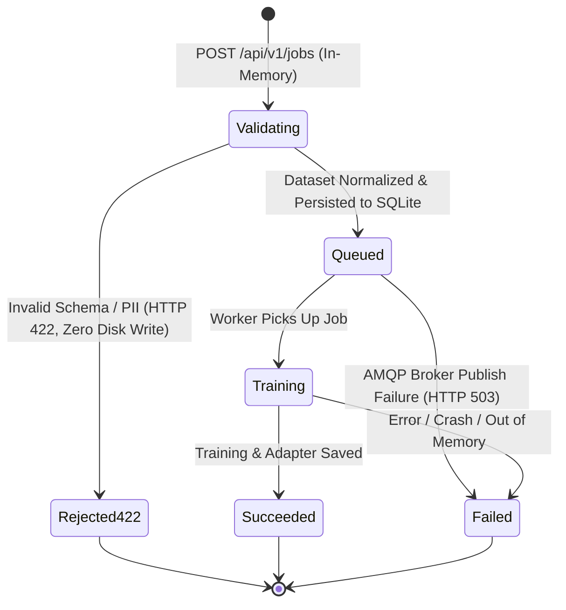

<!-- diagram-meta
  last-validated: 2026-10-26
  validated-commit: c49f2cc
  covers: [src/**, tests/**, scripts/**]
  generated-by: manual
-->

# Event-Driven "Fine-Tuning as a Service" (FTaaS)

An enterprise-grade, asynchronous, event-driven ML platform demonstrating a polyglot microservice pattern (.NET 10 and Python), decoupled compute orchestration, experiment telemetry (MLflow), parameter-efficient fine-tuning (PEFT/LoRA), and dynamic model serving.

---

## 1. System Architecture Overview

```mermaid
flowchart TD
    subgraph Presentation["Presentation & Non-Tech Interface"]
        UI[FTaaS Enterprise Studio: Single Page Web App]
        UI -->|Browse personas & templates| API
        UI -->|Drag-drop CSV/JSONL dataset| API
        UI -->|1-Click Train Team Adapter| API
        UI -->|Side-by-side comparison arena| API
        QA[Playwright QA Walkthrough Suite] -.->|End-to-end verification & visual checkpoints| UI
    end

    subgraph Client["Client Applications / Ingestion"]
        UI -->|POST /api/v1/jobs multipart or datasetPath| API[".NET 10 Ingestion Gateway :5100<br/><code>src/FtaaSService.Api/Program.cs</code>"]
        C[CLI / API Caller] -->|POST /api/v1/jobs| API
        API -->|GET /api/v1/jobs/{id}| DB["SQLite Job State Repository<br/><code>src/FtaaSService.Api/Storage/SqliteJobRepository.cs</code>"]
        API -->|POST /api/v1/inference/compare| INF["Inference Engine :8000<br/><code>src/FtaaSService.Inference/app.py</code>"]
    end

    subgraph DataArbiter["Data Arbiter & Verification (Clean-Room AGPL-3.0 Microservice)"]
        API <-->|Preflight dataset ablation & surprisal audit :5200| HOWSO["howso-service :5200<br/><code>src/howso-service/service.py</code>"]
        API <-->|Verify completion provenance & attribution :5200| HOWSO
    end

    subgraph Broker["Messaging Layer (RabbitMQ AMQP)"]
        API -->|2. Publish: 'finetune.job.requested'| RMQ[RabbitMQ Exchange / Queue]
        PW -.->|5. Publish: 'finetune.job.updated'| RMQ
        RMQ -.->|6. Consume status events| API
        RMQ -.->|DLX / Retry| DLQ[(Dead Letter Queue)]
    end

    subgraph Storage["Storage & Tracking"]
        API -->|Store dataset & compute SHA-256| DISK[(Data Storage / JSONL)]
        API <--> DB
        PW <--> MLF[MLflow Tracking Server]
        MLF <--> ART[(Artifact Store / LoRA Adapters)]
    end

    subgraph Compute["Training Compute Worker (Python)"]
        RMQ -->|3. Consume job| PW["Python Training Worker<br/><code>src/FtaaSService.Worker/consumer.py</code>"]
        PW -->|Load JSONL via datasetPath| DISK
        PW -->|Apply LoRA & Sample-Weighted Loss| TR["PyTorch PEFT LoRA Trainer<br/><code>src/FtaaSService.Worker/trainer.py</code>"]
        TR -->|4. Stream step loss & hardware metrics| MLF
        TR -->|Save adapter weights| ART
    end

    subgraph Serving["Dynamic Model Serving"]
        API -->|Proxy or Call| INF
        INF -->|Load Base Weights| HF["SmolLM2 / Gemma (PyTorch) & BitNet C++ Engine<br/><code>src/FtaaSService.Inference/bitnet_engine.py</code>"]
        INF -->|Mount LoRA Adapter by JobId or URI| ART
        INF -->|Return Side-by-Side Completions| API
    end
```

---

## 2. Core Architectural Principles & Trade-offs

1. **Polyglot Microservices**:
   - **.NET 10 Ingestion Gateway**: High-performance, strongly-typed REST API managing multipart dataset ingestion, schema validation, state machine enforcement, and AMQP publishing with correlation tracking. Hosts the static **FTaaS Enterprise Studio** single-page web app with zero extra port overhead.
   - **Python 3.12 Training Worker**: Specialized ML engine focusing strictly on compute-heavy PyTorch / Hugging Face PEFT fine-tuning, telemetry streaming, and artifact persistence.
2. **Decoupled Job Lifecycle & Out-of-Band Data Handling**:
   - Datasets are stored out-of-band as `.jsonl` files on disk/storage. Only the relative `datasetPath` and a cryptographic `datasetHash` (SHA-256) travel over the message broker, keeping message payloads lightweight.
   - Web requests return immediately with `Accepted (202)` and a unique `JobId`.
3. **Hardware-Adaptive & Local-First (Zero Cloud Cost)**:
   - Automated device detection (`mps` on Apple Silicon, `cuda` on Nvidia, or multi-threaded `cpu`).
   - Tiered baseline models:
     - **SmolLM2-135M** (`HuggingFaceTB/SmolLM2-135M`): Ultra-compact baseline (2,048-token context, ~1,500 words / ~3–4 pages, LoRA rank 8, alpha 32, ~1.8 MB adapter) fine-tuning in 2–4 minutes on Apple Silicon (M1–M4) or CUDA.
     - **Google Gemma 2 2B IT** (`google/gemma-2-2b-it`): High-capacity reasoning tier (8,192-token context, ~6,000 words / ~12–15 single-spaced pages, LoRA rank 8, alpha 32, ~12.2 MB adapter) utilizing Gemma chat templates (`<start_of_turn>`) with hardware preflight gates (~8 GB VRAM requirement and Hugging Face license check).
     - **Microsoft BitNet b1.58 2B-4T** (`microsoft/BitNet-b1.58-2B-4T`): 1.58-bit ternary foundation model ($W \in \{-1, 0, +1\}$, 4,096-token architectural context, ~3,000 words / ~6–8 pages, with bounded 16-token generation and 240-token embedding ceilings) operating at ~1.10 GB RAM footprint via integer addition/subtraction, delivering up to 23.5 tokens/sec decode entirely on CPU (zero GPU required).
4. **Observable MLOps & Distributed Tracing**:
   - Unified `JobId` correlation across HTTP headers, AMQP properties, Python structured logs, and MLflow experiment tags.
   - Step-level loss curves, learning rate, and duration recorded in MLflow.
5. **Resilience & Dead Lettering**:
   - Worker implements message acknowledgment (`ack`/`nack`) with retry policies and DLQ routing for poison messages.
   - Pre-persistence schema & PII validation rejects malformed inputs in-memory (`HTTP 422` with zero disk write), while persisted jobs follow explicit monotonic state transitions (`Queued` $\rightarrow$ `Training` $\rightarrow$ `Succeeded` / `Failed`).
6. **Non-Technical Democratization & Presentation Layer**:
   - Solves the gap between complex ML infrastructure and business value.
   - **Side-by-Side Comparison Arena**: Directly showcases the business contrast between a generic foundational model and a team-tuned LoRA adapter (e.g. enforcing Reg CC, FDIC, or internal SLAs).
   - **No-Code Adapter Studio**: Empowers support and compliance leads to curate prompt-completion examples and launch fine-tuning jobs via simple visual tables and drag-and-drop CSV/JSONL.
   - **Hybrid Simulation Fallback**: If the GPU/MPS inference container is offline or pre-warming, the API transparently serves realistic domain comparisons so business stakeholders can explore without engineering friction (configurable via `STUDIO_PREVIEW_FALLBACK` / `PreviewFallbackEnabled`).
   - **Automated Playwright QA Baseline**: End-to-end headless browser validation (`scripts/qa-walkthrough.sh`) ensuring zero console errors, full DOM verification across all 5 studio stages, and regression-proof visual checkpoints.

---

## 3. Data Contracts & Event Schemas

### A. Job Submission API (`POST /api/v1/jobs`)
Supported input: `multipart/form-data` with dataset file or JSON body with `datasetPath`. When `baseModel` is omitted, `google/gemma-2-2b-it` is selected by default (`SupportedModels.Gemma2_2B_IT`).

```json
{
  "jobName": "financial-sentiment-analysis",
  "baseModel": "HuggingFaceTB/SmolLM2-135M",
  "datasetPath": "datasets/financial-sentiment-train.jsonl",
  "enableHowsoPreflight": true,
  "hyperparameters": {
    "epochs": 3,
    "batchSize": 4,
    "learningRate": 0.0002,
    "loraRank": 8,
    "loraAlpha": 32,
    "loraDropout": 0.05
  }
}
```

**Response (`202 Accepted`):**
```json
{
  "jobId": "f47ac10b58cc4372a5670e02b2c3d479",
  "jobName": "financial-sentiment-analysis",
  "status": "Queued",
  "baseModel": "HuggingFaceTB/SmolLM2-135M",
  "datasetPath": "datasets/f47ac10b58cc4372a5670e02b2c3d479.jsonl",
  "datasetHash": "e3b0c44298fc1c149afbf4c8996fb92427ae41e4649b934ca495991b7852b855",
  "createdAt": "2026-09-14T20:10:00Z",
  "howsoAudit": {
    "originalCount": 25,
    "cleanedCount": 22,
    "ablatedCount": 2,
    "anomalousCount": 1,
    "meanSurprisal": 1.42
  },
  "howsoPreflightStatus": "Audited"
}
```

### B. Broker Message Contract (`finetune.job.requested`)
Sent to exchange `ftaas.direct`, routing key `job.requested`.
```json
{
  "jobId": "f47ac10b58cc4372a5670e02b2c3d479",
  "jobName": "financial-sentiment-analysis",
  "baseModel": "HuggingFaceTB/SmolLM2-135M",
  "datasetPath": "datasets/f47ac10b58cc4372a5670e02b2c3d479.jsonl",
  "datasetHash": "e3b0c44298fc1c149afbf4c8996fb92427ae41e4649b934ca495991b7852b855",
  "hyperparameters": {
    "epochs": 3,
    "batchSize": 4,
    "learningRate": 0.0002,
    "loraRank": 8,
    "loraAlpha": 32,
    "loraDropout": 0.05
  },
  "submittedAt": "2026-09-14T20:10:00Z"
}
```

> **Note on Storage Paths**: `datasetPath` is resolved relative to the configured `DATA_ROOT` environment variable (default: `./data`), avoiding brittle host-specific absolute paths between containers and local processes.

### C. Status Event Contract (`finetune.job.updated`)
Sent to exchange `ftaas.direct`, routing key `job.updated`.
> **Throttling Policy**: While MLflow receives telemetry on every step, RabbitMQ status events are throttled to every 25% of total steps (`max(2, total_steps // 4)`) and final step completion plus state transitions (`Training`, `Succeeded`, `Failed`) to prevent queue chattiness.

```json
{
  "jobId": "f47ac10b58cc4372a5670e02b2c3d479",
  "status": "Training",
  "sequenceNumber": 4,
  "progressPercent": 45.0,
  "currentStep": 45,
  "totalSteps": 100,
  "currentLoss": 0.321,
  "mlflowExperimentId": "1",
  "mlflowRunId": "9b1deb4d3b7d4bab8a7f",
  "adapterPath": "artifacts/1/9b1deb4d/artifacts/model_adapters",
  "errorMessage": null,
  "startedAt": "2026-09-14T20:10:05Z",
  "finishedAt": null,
  "updatedAt": "2026-09-14T20:12:15Z"
}
```

**Allowed `status` enum values**:
- `"Pending"`: Defined in `JobStatus` enum for pre-queue initialization; in-memory validation executes synchronously prior to SQLite persistence.
- `"Queued"`: Dataset validated, normalized, persisted to `DATA_ROOT`, and message published to AMQP.
- `"Training"`: Worker has dequeued message and commenced model training.
- `"Succeeded"`: Training complete, adapter exported, run closed in MLflow.
- `"Failed"`: Fatal error encountered (broker publish failure, OOM, or unrecoverable worker exception).

**Idempotency & Ordering Guard**:
`SqliteJobRepository.UpdateStatusIdempotentAsync` validates `sequenceNumber` and terminal status against the current entity state. Out-of-order events (`sequenceNumber <= current`) or events arriving after terminal states (`Succeeded` or `Failed`) are idempotently ignored.

### D. Inference Comparison API (`POST /api/v1/inference/compare`)
```json
{
  "jobId": "f47ac10b58cc4372a5670e02b2c3d479",
  "prompt": "Analyze quarterly report: Gross margin expanded 320 bps to 41.5% with inventory down 8% YoY.",
  "maxTokens": 64,
  "temperature": 0.2
}
```

**Response (`200 OK`):**
```json
{
  "jobId": "f47ac10b58cc4372a5670e02b2c3d479",
  "baseModel": "HuggingFaceTB/SmolLM2-135M",
  "adapterPath": "data/artifacts/f47ac10b58cc4372a5670e02b2c3d479/adapter",
  "prompt": "Analyze quarterly report: Gross margin expanded 320 bps to 41.5% with inventory down 8% YoY.",
  "baseCompletion": " The company reported financial results for the quarter with numbers and data regarding margin...",
  "fineTunedCompletion": "SENTIMENT: Positive | KEY_METRICS: Gross margin +320bps, Inventory -8% | ASSESSMENT: Operational efficiency and pricing leverage intact.",
  "latencyMs": {
    "baseModel": 182,
    "fineTuned": 195
  }
}
```

**Conflict / Base Model Mismatch Response (`409 Conflict`):**
If an adapter was trained on a model different from the currently running base model, the inference server intercepts the mismatch and returns:
```json
{
  "status_code": 409,
  "detail": {
    "error": "base_model_mismatch",
    "message": "Adapter was trained on 'google/gemma-2-2b-it' but the inference service has 'HuggingFaceTB/SmolLM2-135M' loaded. Outputs would be garbage.",
    "adapterBaseModel": "google/gemma-2-2b-it",
    "loadedBaseModel": "HuggingFaceTB/SmolLM2-135M",
    "hint": "Restart the inference service with BASE_MODEL_NAME=google/gemma-2-2b-it"
  }
}
```

### E. Studio Presentation Contracts

#### 1. Supported Models Catalog (`GET /api/v1/studio/models`)
Returns the dynamic model catalog (`SupportedModels.Catalog`), parameter specifications, and hardware disclaimers:
```json
[
  {
    "modelId": "google/gemma-2-2b-it",
    "displayName": "Gemma 2 2B IT",
    "parameterCount": "2B",
    "contextLength": 8192,
    "minGpuVramGb": 8.0,
    "requiresHfAuth": true,
    "hardwareDisclaimer": "Requires ~8 GB GPU VRAM for training and ~5 GB for inference. Accept the Gemma license at huggingface.co/google/gemma-2-2b-it and set the HF_TOKEN environment variable before starting the worker.",
    "isExperimental": false,
    "tooltip": null
  },
  {
    "modelId": "HuggingFaceTB/SmolLM2-135M",
    "displayName": "SmolLM2-135M",
    "parameterCount": "135M",
    "contextLength": 2048,
    "minGpuVramGb": 0.5,
    "requiresHfAuth": false,
    "hardwareDisclaimer": null,
    "isExperimental": false,
    "tooltip": null
  },
  {
    "modelId": "microsoft/BitNet-b1.58-2B-4T",
    "displayName": "BitNet b1.58 2B-4T (Experimental)",
    "parameterCount": "2.4B",
    "contextLength": 4096,
    "minGpuVramGb": 0.0,
    "requiresHfAuth": false,
    "hardwareDisclaimer": "1.58-bit ternary weight model. Executes natively on CPU using AVX2 SIMD integer operations (zero GPU VRAM required). Inference requires the bitnet.cpp C++ runtime.",
    "isExperimental": true,
    "tooltip": "Experimental Research Architecture: 1.58-bit ternary CPU execution. Embedding context bounded to <= 240 tokens (upstream AVX2 batch ceiling); generation bounded to <= 16 prompt tokens (context breakdown boundary). Production statutory retrieval operates in Retrieval-Only mode."
  }
]
```

#### 2. Persona Catalog (`GET /api/v1/studio/personas`)
Returns curated business personas, sample customer tickets, compliance checklists, and seed prompt-completion pairs.
```json
[
  {
    "id": "fintech-compliance",
    "name": "Fintech Support & Compliance Copilot",
    "department": "Risk, Support & Operations",
    "description": "Enforces Reg CC ACH hold limits, BSA/AML verification, and mandatory FDIC insurance notices.",
    "adapterSize": "1.8 MB",
    "complianceRules": [
      "Mandatory FDIC deposit status disclaimer",
      "Reg CC 3-5 business day ACH clearance notification for >$10K"
    ],
    "samplePrompts": [
      {
        "title": "ACH Deposit Clearance Delay",
        "prompt": "Customer ticket: User states their account transfer of $15,000 is delayed..."
      }
    ]
  }
]
```

#### 3. System & Adapter Overview (`GET /api/v1/studio/overview`)
Provides aggregate stats for non-technical dashboard rendering.
```json
{
  "totalJobs": 7,
  "succeededJobs": 4,
  "trainingJobs": 0,
  "queuedJobs": 0,
  "baseModel": "HuggingFaceTB/SmolLM2-135M",
  "adapterFootprint": "~1.8 MB"
}
```

---

## 4. Job State Lifecycle & Validation Machine



**State Transition Rules:**
- **Pre-Persistence Validation (`Validating` $\rightarrow$ `Rejected422` or `Queued`)**: Dataset schema, token heuristics, and PII guardrails run strictly in-memory prior to SQLite persistence. Invalid or non-compliant datasets return `422 Unprocessable Entity` with zero bytes written to disk.
- `Validating` $\rightarrow$ `Queued`: Job record is persisted in SQLite (`JobStatus.Queued`) only after dataset normalization (and optional Howso preflight audit) succeeds.
- `Queued` $\rightarrow$ `Training`: Worker consumer acquires AMQP message and starts loading weights.
- `Training` $\rightarrow$ `Succeeded`: Adapter weights are written (`adapter_config.json`, `adapter_model.safetensors`) and MLflow run closes cleanly.
- **Idempotent Terminal Guard**: Stale (`sequenceNumber <= current`) or post-terminal (`Succeeded`, `Failed`) status events are idempotently ignored by `SqliteJobRepository.UpdateStatusIdempotentAsync`.

---

## 5. Phased Implementation Roadmap

### Phase 1: Local Infrastructure & Developer Experience Foundation
- `docker-compose.yml`:
  - **RabbitMQ**: AMQP message broker with management UI (port 5672 / 15672) and healthcheck.
  - **MLflow Server**: Tracking server with SQLite backend and local artifact mount (host port 5001 mapped to container port 5000) and healthcheck.
- `scripts/dev-up.sh`: Automated orchestrator that starts Docker, waits for container healthchecks, creates requisite directory structure, and seeds sample JSONL datasets.
- Correlation logging and local folder layout setup.

### Phase 2: Ingestion & Control Plane (.NET 10)
- .NET 10 Minimal API project (`FtaaSService.Api`).
- Dataset ingestion handler:
  - File upload (`multipart/form-data`) and pre-existing path support.
  - Schema validator (JSONL parsing, token heuristics, empty validation).
  - SHA-256 hash generator.
- SQLite job state repository tracking all lifecycle fields (`startedAt`, `finishedAt`, `mlflowRunId`, `errorMessage`, `adapterUri`).
- RabbitMQ publisher & consumer for status synchronization:
  - Publishes `finetune.job.requested`.
  - Background worker consuming `finetune.job.updated` to update database state with idempotency.
- Health endpoint (`GET /healthz`).

### Phase 3: Python Compute Worker & LoRA Pipeline (Core Engine)
- Python 3.12 worker (`FtaaSService.Worker`).
- Resilient AMQP consumer:
  - Correlation ID tracking and structured logging.
  - Dead-letter handling and nack on transient failures.
  - Publishes progress events (`finetune.job.updated`).
- Training engine:
  - Auto hardware detection (`mps`, `cuda`, `cpu`).
  - Hugging Face PEFT LoRA adapter injection (`r=8`, `alpha=32`).
  - Native MLflow telemetry streaming (step-level loss, runtime, epoch progress).
  - Adapter weight export (`adapter_config.json`, `adapter_model.safetensors`).

### Phase 4: Dynamic Model Serving & Side-by-Side Comparison
- Inference service (`FtaaSService.Inference`) exposing dynamic adapter mounting:
  - Keeps base model in memory.
  - Mounts requested LoRA adapter dynamically using `PeftModel.from_pretrained(base_model, adapter_path)`.
  - Side-by-side comparison endpoint (`POST /api/v1/inference/compare`) returning base vs fine-tuned completions.
  - API Gateway route proxying comparison through .NET 10 API.

### Phase 5: Evaluation, Governance & Portfolio Polish (Milestone Polish)
- Post-training test split benchmark evaluation logged directly to MLflow.
- MLflow Model Registry integration with tagging (`stage=staging`, `dataset_hash=...`).
- End-to-end automated verification script (`scripts/verify-e2e.sh`).
- Documentation:
  - Architecture breakdown and "Why this architecture?" design trade-off rationale.
  - Cloud mapping runbook (AWS SQS + SageMaker Training Jobs + ECR / GCP Vertex AI equivalents).

### Phase 6: Multi-Model Scaling & Gemma 2B Prototype
- Dynamic `model_registry.py` module defining `ModelSpec`, model-specific chat templates (`chatml` vs `gemma`), and target projection modules (`q_proj, v_proj` vs `q_proj, v_proj, k_proj, o_proj`).
- `google/gemma-2-2b-it` support with Hugging Face gated licensing verification (401/403 friendly error guidance) and hardware preflight warnings (8GB VRAM).
- Precision & Memory Optimization: `torch.float16` on Apple Silicon MPS with dynamic gradient accumulation (`per_device_batch=1`, `accum_steps=batch_size`) and watermark ceiling bypass.
- Dynamic inference conflict guard: HTTP 409 Conflict with actionable restart hint on base model mismatch.
- Documented live prototype benchmark in [`GEMMA_PROTOTYPE_RESULTS.md`](GEMMA_PROTOTYPE_RESULTS.md).

### Phase 7: Ternary Weight Scaling & BitNet b1.58 Prototype
- `microsoft/BitNet-b1.58-2B-4T` catalog integration in `model_registry.py` and `SupportedModels`.
- Ternary weights $W \in \{-1, 0, +1\}$ executing on CPU via AVX2 SIMD integer operations (zero GPU VRAM required).
- Native prompt formatting (`User: <prompt><|eot_id|>\nAssistant: <completion><|eot_id|>`).
- Live CPU scaling benchmarks documented in [`BITNET_PROTOTYPE_RESULTS.md`](BITNET_PROTOTYPE_RESULTS.md) achieving up to 23.54 tokens/sec on Intel Core i9 CPU.
- Full 11-phase execution roadmap documented in [`ROADMAP.md`](ROADMAP.md).
- Baseline edge model profile documented in [`SMOL_PROTOTYPE_RESULTS.md`](SMOL_PROTOTYPE_RESULTS.md).

### Phase 8: 1-Bit Dense Embedding Subsystem (`bitnet-embedding-270m`)
- Dynamic ingestion and serving of Microsoft's 1.58-bit dense embedding model (`bitnet-embedding-270m-bf16-i2_s.gguf`, 350.46 MB on disk) in `bitnet.cpp`.
- 640-dimension embeddings with bounded 240-token safe operational context on AVX2 CPU SIMD (preventing upstream batch decode crash at token 257).
- Empirical hardware profiling via `/usr/bin/time -l` measuring 741.9 MB RSS on short queries and ~1,523.5 MB RSS at 240 tokens.

### Phase 9: Zero-Egress Statutory Pack Retrieval Baseline
- Integrated multi-jurisdiction regulatory corpus: 12 CFR Part 229 (Reg CC), 12 CFR Part 1005 (Reg E), 12 CFR Part 330 (FDIC), 31 CFR Part 1010 (BSA/AML).
- High-efficiency cosine similarity vector search and verifiable primary statutory source fetcher (`verify_statutory_sources.py`).
- Strict AST conclusion invariants and automated Wilson score confidence interval validation (`sync_docs.py`).

### Phase 10: Automated Playwright Studio Walkthrough Suite & Empirical QA Baseline
- Playwright-based browser orchestration (`scripts/qa-walkthrough.sh`, `scripts/qa-walkthrough.js`) executing 46 automated assertions across the entire Studio workflow.
- High-resolution visual checkpoints (`tests/qa-screenshots/01_studio_initialization.png` through `05_adapter_library_loaded.png`).
- Zero console error tolerance and fail-closed validation across PII guardrails, persona switching, and side-by-side comparison.

---

## 6. Production Cloud & FinOps Architecture Mapping

The local polyglot architecture is designed with full cloud parity, allowing immediate mapping to enterprise cloud environments:

```plaintext
Local Component            AWS Production Architecture                 GCP Production Architecture
---------------------------------------------------------------------------------------------------------
.NET 10 API Gateway        Amazon API Gateway + ECS Fargate (.NET 10)  Cloud Run (.NET 10 container)
RabbitMQ Broker + DLQ      Amazon SQS (FIFO) + SQS Dead Letter Queue   Google Cloud Pub/Sub + Dead Letter
Storage (JSONL & DB)       Amazon S3 (Datasets) + Aurora PostgreSQL    Google Cloud Storage + Cloud SQL
Compute Worker (Python)    SageMaker Training Jobs (Spot Instances)    Vertex AI Custom Jobs (Preemptible)
Experiment Tracker         MLflow on AWS ECS / SageMaker Experiments   Vertex AI Experiments / Managed MLflow
Model Registry             MLflow Registry / SageMaker Model Registry  Vertex AI Model Registry
Dynamic Inference Server   SageMaker Multi-Model / Triton Inference    Vertex AI Endpoints (vLLM / Triton)
```

### FinOps & Cost Optimization Highlights
1. **Spot Compute & Automated Teardown**:
   - Training workers run as ephemeral batch jobs. In AWS, invoking `sagemaker.create_training_job` with `EnableManagedSpotTraining=True` yields up to **70–90% compute cost savings**.
   - Spot interruption handling is mirrored by our AMQP nack/requeue policy.
2. **Adapter-Only Storage & Serving**:
   - Traditional fine-tuning duplicates full model weights (~3GB–14GB per domain).
   - LoRA exports only rank-decomposition matrices (~1.8MB per adapter). 500 domain-specific fine-tuned models require less than 1GB of total storage, and can be served dynamically on a single warm base-model instance without provisioning 500 GPU containers.
3. **Zero-Trust & Data Privacy (SOC-2 Alignment)**:
   - Client datasets never leave the private VPC; only relative dataset storage paths (`datasetPath`) resolved against the local/VPC `DATA_ROOT` (or pre-signed storage URIs in cloud deployments) and content hashes (`datasetHash`) travel in AMQP messages to the training worker. Raw dataset payloads are never embedded in event payloads.
   - Cryptographic SHA-256 hashes guarantee dataset provenance and immutable reproducibility.

---

## 7. Workspace Directory Layout

```plaintext
ml/
├── docker-compose.yml            # RabbitMQ, MLflow, and Howso Data Arbiter services
├── README.md                     # Executive summary, trade-offs & runbook
├── NOTICE.md                     # Legal disclosures, privacy invariants & attribution
├── docs/                         # Engineering documentation & benchmark records
│   ├── ARCHITECTURE.md           # Detailed architecture specifications & contracts
│   ├── ROADMAP.md                # BitNet b1.58 ternary integration roadmap & execution tracking
│   ├── STUDIO_GUIDE.md           # Visual walkthrough & non-technical guide
│   ├── MODEL_PERFORMANCE_COMPARISON.md # Tri-model comparative benchmarks & decision matrix
│   ├── SMOL_PROTOTYPE_RESULTS.md # Baseline ultra-compact SmolLM2-135M benchmark & ONNX profile
│   ├── GEMMA_PROTOTYPE_RESULTS.md # High-capacity reasoning Gemma 2 2B IT benchmark & evaluation
│   ├── BITNET_PROTOTYPE_RESULTS.md # 1.58-bit ternary CPU BitNet b1.58 2B-4T benchmark & evaluation
│   ├── claims_registry.json      # Cryptographic & empirical claims verification database
│   └── PRIVACY_TELEMETRY_SCHEMA.md # Portfolio privacy & telemetry governance schema
├── scripts/
│   ├── dev-up.sh                 # Start infra, check health, seed datasets
│   ├── dev-down.sh               # Tear down infra
│   ├── verify-e2e.sh             # Master single-command verification script
│   ├── qa-walkthrough.sh         # Headless Playwright Studio walkthrough orchestrator
│   ├── qa-walkthrough.js         # Playwright QA verification script & screenshot captures
│   ├── sync_docs.py              # Empirical claims synchronizer & AST linter
│   ├── run_gemma_benchmark.py    # Standalone Gemma 2B live benchmark runner
│   ├── run_bitnet_benchmark.py   # Standalone BitNet live benchmark runner
│   └── seed_dataset.py           # Domain dataset generator
├── tests/
│   ├── FtaaSService.Api.Tests/   # .NET 10 integration, domain, & controller test suite (incl. Howso)
│   ├── test_bitnet_engine.py     # Python BitNet C++ subprocess serving tests
│   ├── test_claims_linter.py     # Empirical claims registry & Wilson interval tests
│   ├── test_howso_service.py     # Howso data arbiter subprocess HTTP, ablation, and surprisal tests
│   ├── test_trainer_model_selection.py # Python PEFT/LoRA training & sample-weighted loss unit tests
│   └── qa-screenshots/           # Playwright UI visual baseline checkpoints
├── data/
│   ├── datasets/                 # Ingested and sample JSONL datasets
│   ├── artifacts/                # Exported LoRA adapter weights
│   └── storage/                  # SQLite db files
├── src/
│   ├── FtaaSService.Api/         # .NET 10 Ingestion Gateway & Control Plane
│   │   ├── Domain/               # Job state machine, entities, validation, SupportedModels
│   │   ├── Endpoints/            # Minimal API endpoints (Jobs, Inference, Studio, Health)
│   │   ├── Messaging/            # RabbitMQ producer & status consumer
│   │   ├── Services/             # Dataset normalization & Howso client integration
│   │   ├── Storage/              # SQLite repository
│   │   ├── wwwroot/              # FTaaS Studio Single Page App (index.html, studio.js)
│   │   ├── appsettings.json      # Service configuration & preview fallback settings
│   │   ├── FtaaSService.Api.csproj
│   │   └── Program.cs
│   ├── FtaaSService.Worker/      # Python Training Worker
│   │   ├── config.py             # Settings & device detection
│   │   ├── model_registry.py     # Multi-model registry, specs & chat templates
│   │   ├── consumer.py           # RabbitMQ consumer & DLQ logic
│   │   ├── trainer.py            # LoRA fine-tuning, sample-weighted loss & MLflow telemetry
│   │   ├── exporter.py           # Edge ONNX manifest & adapter exporter
│   │   ├── evaluator.py          # Benchmark metric calculation
│   │   └── requirements.txt
│   ├── FtaaSService.Inference/   # Dynamic Adapter Serving Engine
│   │   ├── app.py                # FastAPI dynamic serving endpoint & routing
│   │   ├── bitnet_engine.py      # Native BitNet C++ AVX2 SIMD serving engine
│   │   └── requirements.txt
│   └── howso-service/            # Containerized Clean-Room Reference Information Engine (AGPL-3.0 HTTP Boundary)
│       ├── Dockerfile            # Standalone container specification (port 5200)
│       ├── service.py            # Clean-room Laplace-LK information-theoretic ablation & attribution engine
│       ├── requirements.txt      # FastAPI, Uvicorn, and Pydantic dependencies (zero upstream Howso/Amalgam packages)
│       └── LICENSE-AGPL.txt      # AGPL-3.0 license disclosure
```
